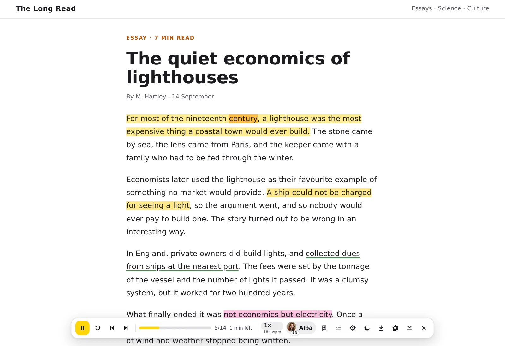

# Aloud

**Reads any web page or PDF aloud in a natural voice that runs on your own computer.**
No account, no cloud, nothing sent anywhere: once a voice is downloaded, it works offline.

**[Firefox](https://addons.mozilla.org/firefox/addon/aloud-natural-text-to-speech/)** (desktop and Android) ·
**[Chrome](https://chromewebstore.google.com/detail/ilnojbdjpnnlkjbmldpgbgckkkifheeo)** (and Edge, Brave, Opera) ·
**[Website](https://aloud.souj.dev)**

<picture>
  <source media="(prefers-color-scheme: dark)" srcset="website/assets/shots/reading-dark.webp">
  
</picture>

## What it does

- **Reads the article, not the page.** Menus, ads and buttons are left out. It reads what you can
  see, and follows along with a highlight on the sentence and the word being spoken.
- **Natural voices, on your device.** Four families of neural voices in up to 49 languages. A page
  in two languages is read by two voices, each in its own.
- **PDFs too,** shown as real pages, with the sentence highlighted on the page itself. You can
  mark them up and save the marks into the file.
- **Up to 4× speed,** and every speed is the real one, at the same pitch.
- **Picks up where you stopped,** on this device or, if you connect your own Dropbox, on your others.
- **Highlights and notes on any page,** kept and shown again when you come back.
- **Save as MP3:** the whole page in the voice and speed you chose.
- **A speed control for every video and audio player** on the web, YouTube Shorts included: faster,
  slower, rewind and skip from the keyboard, or with a button you can drag on a phone.

## Voices

| | Languages | Download | Best for |
|---|---|---|---|
| **Phonon** (the default) | English, French, German, Spanish, Portuguese · 102 voices | about 100 MB | Fast on any computer, no graphics card needed |
| **Piper** | 49 languages · 171 voices | 20–140 MB per voice | Phones, and languages the others lack |
| **Supertonic 3** | 31 languages · 10 voices | about 400 MB | Many languages in one download |
| **Kokoro** | English, plus Spanish, French, Hindi, Italian, Portuguese · 41 voices | 114 MB, or 347 MB with a graphics card | The richest English, on a graphics card |

Kokoro and Supertonic are much faster when the browser lets Aloud use your graphics card.
[Using your graphics card](https://aloud.souj.dev/gpu.html) explains how, and what to do if a voice
comes out silent or garbled. Settings → Advanced tells you which applies to your machine.

## Your privacy

There is no Aloud server. What you read, your notes and your history stay in your browser. Aloud
only goes online when you ask it to: to download a voice (from Hugging Face), to fetch a page or
PDF you asked it to read, or to sync through a Dropbox you connected yourself.
[The privacy policy](https://aloud.souj.dev/privacy.html) has every detail.

## Keys

| | Firefox | Chrome |
|---|---|---|
| Read this page, or stop | <kbd>Alt</kbd>+<kbd>R</kbd> | <kbd>Alt</kbd>+<kbd>R</kbd> |
| Read the selection / read from here | <kbd>Alt</kbd>+<kbd>L</kbd> / <kbd>Alt</kbd>+<kbd>G</kbd> | choose in `chrome://extensions/shortcuts` |
| Highlight the selection and keep it | <kbd>Alt</kbd>+<kbd>K</kbd> | <kbd>Alt</kbd>+<kbd>K</kbd> |
| Show your notes on this page | <kbd>Alt</kbd>+<kbd>N</kbd> | <kbd>Alt</kbd>+<kbd>N</kbd> |
| Video speed control on or off | <kbd>Alt</kbd>+<kbd>M</kbd> | <kbd>Alt</kbd>+<kbd>M</kbd> |

While a page is being read: <kbd>P</kbd> play or pause, <kbd>S</kbd> / <kbd>D</kbd> slower or
faster, <kbd>R</kbd> normal speed, <kbd>Z</kbd> / <kbd>X</kbd> back or forward a sentence,
<kbd>N</kbd> keep the sentence in your notes, <kbd>F</kbd> scroll back to it.

On a video: <kbd>S</kbd> / <kbd>D</kbd> slower or faster, <kbd>G</kbd> your speed,
<kbd>R</kbd> normal, <kbd>Z</kbd> / <kbd>X</kbd> back or forward 10 seconds, <kbd>M</kbd> mute.

Every key can be changed in Settings → Shortcuts.

## Build it yourself

You need Node 22.12 or later.

```bash
npm ci
npm run build      # .output/firefox-mv3 and .output/chrome-mv3
```

Load `.output/firefox-mv3/manifest.json` in Firefox (`about:debugging` → This Firefox → Load
Temporary Add-on), or the `.output/chrome-mv3` folder in Chrome (`chrome://extensions` → Developer
mode → Load unpacked). Each browser needs its own folder.

[BUILD.md](BUILD.md) covers the tests, the release checks and the Safari build;
[docs/DESIGN.md](docs/DESIGN.md) explains how it works and why.

## Help and feedback

Found a bug, or a page it reads wrongly? [Open an issue](https://github.com/smailoujaoura/aloud/issues)
or use the [feedback page](https://aloud.souj.dev/feedback.html).

## Licence

GPL-3.0-or-later. [THIRD_PARTY.md](THIRD_PARTY.md) lists everything Aloud is built from. Voices
are not included: each is downloaded when you choose it, under its own licence
([PIPER_VOICE_LICENCES.md](PIPER_VOICE_LICENCES.md) for Piper's; Phonon's is for non-commercial use).

Made by Smail Oujaoura with [Claude Code](https://claude.com/product/claude-code).
